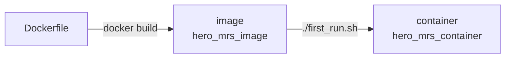

# Docker, tmux, simulation and robots

In this tutorial you will learn the basics of Docker and tmux, move robots in the hero_sim simulator, and then fly a real Crazyflie and drive a real herover. Each section ends with a short hands-on exercise.

---
## Docker

At this level, you can think of Docker as a kind of virtual machine. That isn't exactly what it is, but it's close enough. It lets everyone work in the same system, with the same versions of ROS 2 and every library, no matter what's installed on their laptop. 

Two words you'll see a lot:
- **Image**: a recipe for the system, built once from the `Dockerfile`. Think of it as an installer.
- **Container**: a running copy of the image. This is where you work. Your changes in it stay until you delete it.



Common commands. Run them on your laptop, not in the container:
- `docker start -i hero_mrs_container` - starts the container and opens a terminal in it,
- `docker exec -it hero_mrs_container bash` - opens another terminal in the running container,
- `docker stop hero_mrs_container` - stops the container,
- `docker ps -a` - lists all containers and whether they're running,
- `docker rm hero_mrs_container` - deletes the container.

**NOTA BENE**
- Two folders in the container are folders on your laptop: your package (`~/ros2_ws/src/my_package`, the one you set in `first_run.sh`) and `~/ros2_ws/src/hero_mrs` (the `hero_mrs_docker` folder). Files there are safe even if you delete the container.
- Everything else in the container is deleted with `docker rm`.

### Hands-on #1

1. Build the image and create the container: follow [Build the image](../README.md#build-the-image-once) and [Create the container](../README.md#create-the-container-once) in the main README. You end up in a terminal inside the container.
2. Look at the ROS 2 workspace:
    ```bash
    ls ~/ros2_ws/src
    ```
    You should see `hero_mrs`, `hero_sim`, `crazyswarm2` and your own package, among others.
3. Start a ROS 2 node that publishes messages:
    ```bash
    ros2 run demo_nodes_py talker
    ```
4. On your laptop, open a second terminal in the same container and listen to the messages:
    ```bash
    docker exec -it hero_mrs_container bash
    ros2 run demo_nodes_py listener
    ```
5. Stop both nodes with `Ctrl+c`. In the second terminal, make a file:
    ```bash
    touch ~/hello.txt
    ```
6. Close both terminals with `exit`. Then start the container again and check that your file is still there:
    ```bash
    docker start -i hero_mrs_container
    ls ~
    ```

---
## tmux

You'll often need many terminals at once: the simulator in one, your code in another, and a third to check topics. tmux gives you many terminals in one window. The start scripts in this container also use it: they open a tmux session with every node in its own pane.

- A **session** is a group of windows. It keeps running when you close the terminal.
- A **window** is like a browser tab.
- A **pane** is a part of a window. A window can be split into several.

The keys in this container. `Ctrl+b, c` means: press `Ctrl+b`, let go, then press `c`.

| Keys | Does |
|---|---|
| `Ctrl` + arrows | move to the pane left, right, up or down |
| `Shift` + left/right | go to the previous/next window |
| `Ctrl+b, c` | new window |
| `Ctrl+b, %` | split the pane left and right |
| `Ctrl+b, "` | split the pane top and bottom |
| `Ctrl+b, [` | scroll through a pane's output (arrows or PgUp/PgDn, `q` to stop) |
| `Ctrl+b, d` | leave the session; it keeps running |
| `Ctrl+b, k` | **stop everything in the session** and close it |

Commands:
- `tmux new -s name` - starts a new session,
- `tmux ls` - lists the sessions,
- `tmux attach -t name` - goes back to a session you left,
- `tmux kill-session -t name` - stops a session.

### Hands-on #2

1. Start a session:
    ```bash
    tmux new -s practice
    ```
2. Split the window with `Ctrl+b, %`. Run `ros2 run demo_nodes_py talker` in the left pane. Move to the right pane with `Ctrl` + right arrow and run `ros2 run demo_nodes_py listener`.
3. Open a new window with `Ctrl+b, c` and run `ros2 topic list`. Go back to the first window with `Shift` + left arrow.
4. Leave the session with `Ctrl+b, d`. The nodes keep running: check with `tmux ls`. Go back with `tmux attach -t practice`.
5. Stop everything with `Ctrl+b, k`.

---
## Simulation: hero_sim

Robots are expensive and slow to set up, so in robotics you test everything in simulation first. hero_sim shows Crazyflies and ground robots (herover, scout) in RViz. There's no physics: robots move exactly as commanded, so it starts in seconds.

You command the simulated robots through the same ROS 2 topics and services as the real ones. Code that works in hero_sim should work on the real robots with only small changes, like lower speeds.

<p align="center">
  
</p>

A **scenario** is a YAML file in `~/ros2_ws/src/hero_sim/config/`. It says which robots there are, where they start, and what obstacles there are. Everything else is in the [hero_sim README](https://github.com/larics/hero_sim).

The main commands:

| Robot | Command | Topic or service |
|---|---|---|
| ground robot | drive with a velocity, in its own frame | topic `/<name>/cmd_vel` |
| Crazyflie | take off, fly to a point, land | services `/cf_1/takeoff`, `/cf_1/go_to`, `/cf_1/land` |
| any | where it is | topic `/<name>/pose` |

### Hands-on #3

1. Start the example scenario: a herover, a scout, two Crazyflies and a pillar.
    ```bash
    cd ~/ros2_ws/src/hero_sim/startup
    bash start.sh example.yaml
    ```
    RViz opens, and you're in a tmux session called `hero_sim`.
2. Open a new tmux window (`Ctrl+b, c`) and drive the herover forward, then stop it:
    ```bash
    ros2 topic pub --once /herover_1/cmd_vel geometry_msgs/msg/Twist "{linear: {x: 0.3}}"
    ros2 topic pub --once /herover_1/cmd_vel geometry_msgs/msg/Twist "{}"
    ```
3. Drive it with the keyboard (follow the keys it prints, `Ctrl+c` to stop):
    ```bash
    ros2 run teleop_twist_keyboard teleop_twist_keyboard --ros-args -r __ns:=/herover_1
    ```
4. Take off with `cf_1`, fly to a point and land:
    ```bash
    ros2 service call /cf_1/takeoff crazyflie_interfaces/srv/Takeoff "{height: 1.0, duration: {sec: 2}}"
    ros2 service call /cf_1/go_to crazyflie_interfaces/srv/GoTo "{goal: {x: 0.0, y: 0.0, z: 1.0}, duration: {sec: 3}}"
    ros2 service call /cf_1/land crazyflie_interfaces/srv/Land "{height: 0.0, duration: {sec: 2}}"
    ```
5. Watch where `cf_1` is while it flies:
    ```bash
    ros2 topic echo /cf_1/pose
    ```
6. Stop the simulator with `Ctrl+b, k`.
7. Make your own scenario. Copy the example and open it:
    ```bash
    cd ~/ros2_ws/src/hero_sim/config
    cp example.yaml my_test.yaml
    nano my_test.yaml
    ```
    Move a robot, add a Crazyflie or a pillar, then start it with `bash start.sh my_test.yaml` from the `startup` folder.

---
## Real robots

**Always fly and drive with a supervisor in the room.** Before any take-off, everyone stays out of the flying area.

### Crazyflies

Crazyflies are tiny quadcopters, about 27 g. Each one talks to your laptop through a **Crazyradio** USB dongle and has an address like `radio://0/90/2M/E7E7E7E7E1`.

A Crazyflie can't tell where it is by itself. The **motion capture** system (OptiTrack cameras around the room) tracks a marker on each Crazyflie and sends its position to the laptop. The **Crazyflie server** passes it on to the drone and gives you the same services as in the simulator: `takeoff`, `go_to`, `land`.

Which Crazyflies you fly, their addresses and their start positions are in `~/ros2_ws/src/hero_mrs/config/crazyflies_real.yaml`.

**NOTA BENE**
- **Emergency stop**: this cuts the motors of every Crazyflie at once, and they drop. Have it typed in a terminal before every take-off:
    ```bash
    ros2 service call /all/emergency std_srvs/srv/Empty
    ```
- **Battery**: `ros2 topic echo /cf_1/status` shows `battery_voltage`. Above 4 V is full, around 3.1 V is empty. The voltage dips during take-off and climbing, so read it while hovering.
- **cfclient**, the Crazyflie app, is handy for checking a single drone. Close it before starting the Crazyflie server: both can't use the radio at once.

### Hands-on #4

Do this with a supervisor.

1. Plug in the Crazyradio. Put the Crazyflies on the floor at their start positions and switch them on.
2. In `~/ros2_ws/src/hero_mrs/config/crazyflies_real.yaml`, set `enabled: true` only for the Crazyflies on the floor, and `enabled: false` for the rest.
3. Start the Crazyflie server, motion capture and RViz:
    ```bash
    cd ~/ros2_ws/src/hero_mrs/startup
    ./start.sh
    ```
4. Wait until the server prints `All Crazyflies are fully connected!`. Don't fly before that.
5. Open a new tmux window (`Ctrl+b, c`) and type the emergency stop command from above, without pressing Enter yet.
6. Take off, move and land with the same commands as in Hands-on #3. Start small: `height: 0.5`, and a `go_to` close to the start.
7. Stop everything with `Ctrl+b, k`.

### herover

The herover is a small ground robot with mecanum wheels: it can drive forward, sideways and turn on the spot. It gets commands over WiFi, so your laptop must be on the same WiFi network as the robot.

On the laptop, the **bridge** listens to `/herover_1/cmd_vel` and sends every command to the robot. It's the same topic as in the simulator. The robot's address is in `~/ros2_ws/src/herover/config/robots.yaml`.

**NOTA BENE**
- The real herover is slow: at most about 0.17 m/s.
- `go_to` exists only in the simulator. On the real robot, use `cmd_vel`.
- The robot keeps its last command. Always send a stop (`"{}"`) when you're done.

### Hands-on #5

Do this with a supervisor.

1. Connect your laptop to the robots' WiFi and switch the herover on.
2. Start the bridge:
    ```bash
    ros2 run herover cmd_vel_bridge
    ```
3. In another tmux pane, drive it a little and stop it:
    ```bash
    ros2 topic pub --once /herover_1/cmd_vel geometry_msgs/msg/Twist "{linear: {x: 0.1}}"
    ros2 topic pub --once /herover_1/cmd_vel geometry_msgs/msg/Twist "{}"
    ```
4. Drive it with a gamepad (Logitech F710, switch on the back set to **X**). Hold **LB** to drive. The left stick moves it, the right stick turns it, and holding **RB** too makes it faster:
    ```bash
    ros2 launch herover joy_teleop.launch.py
    ```

---
## From simulation to the real robots

The topic and service names are the same, so the same code runs on both. What changes:

| | hero_sim | Real robots |
|---|---|---|
| Positions | perfect | from motion capture, with a little noise |
| Speed | anything you ask, up to 2 m/s | herover about 0.17 m/s, Crazyflies slower than you'd think indoors |
| Ground robot `go_to` | yes | no, use `cmd_vel` |
| Collisions | the robot stops | the robot crashes |

Test in hero_sim first, then on the real robots with low speeds.
